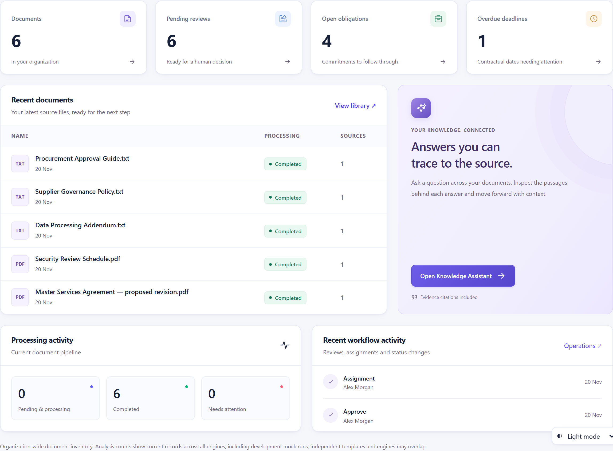
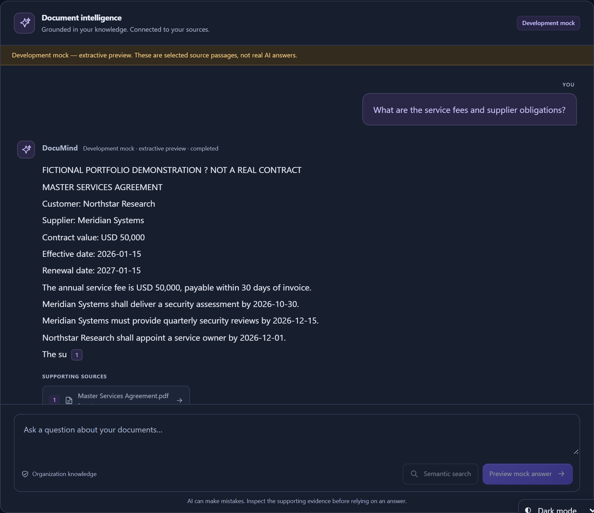
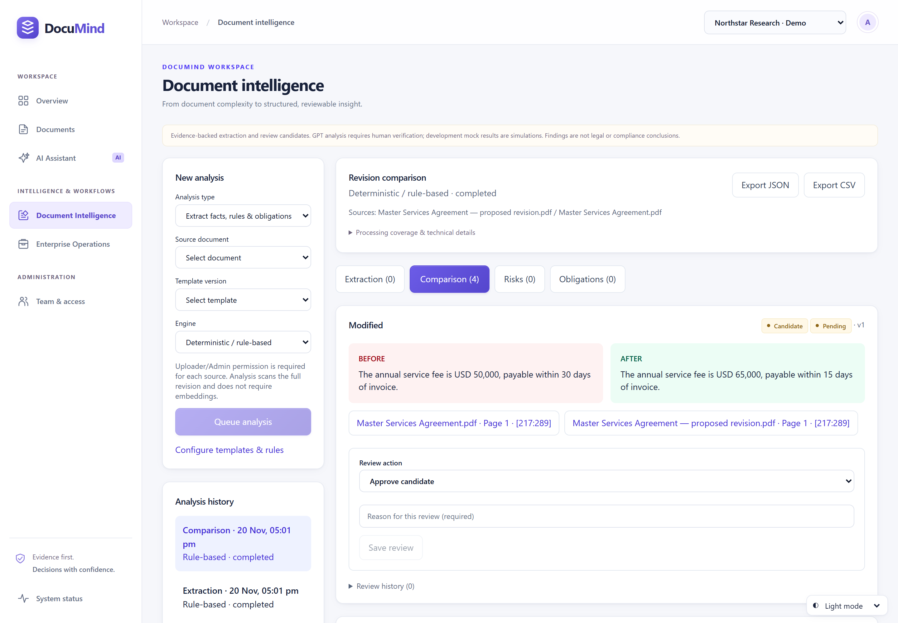

# DocuMind — AI-Powered Document Intelligence

Turn documents into searchable knowledge, grounded answers and reviewable business workflows.
DocuMind is a full-stack portfolio engineering project **designed and developed by Fiza Ahmad**.



*Actual application with fictional demonstration data. Counts describe demo records, not customer outcomes.*

## Key features

- **Document processing:** PDF, DOCX and TXT uploads, text extraction, selective PDF OCR and source-linked chunking.
- **Grounded document Q&A:** semantic retrieval, OpenAI GPT synthesis and application-managed source citations.
- **Structured intelligence:** versioned extraction templates, configured risk rules and obligation candidates.
- **Document comparison:** source-referenced text differences and configured GPT explanations.
- **Scoped access:** organizations, Admin/Member roles, Argon2id passwords, rotating JWT sessions, HttpOnly cookies and CSRF protection.
- **Human workflows:** approve/correct/reject results, assign work and track obligations through PostgreSQL-backed background processing.
- **Usage controls:** token accounting, estimated request costs and organization-level AI budgets.

## Tech stack

| Layer | Technology |
|---|---|
| Frontend | Next.js, React, TypeScript, Tailwind CSS |
| Backend | Python, FastAPI, SQLAlchemy, Alembic |
| Database & retrieval | PostgreSQL, pgvector, cosine-similarity search |
| Local embeddings | Sentence Transformers, all-MiniLM-L6-v2 (384 dimensions by default) |
| Generative AI | OpenAI Responses API through a provider-independent interface |
| Document processing | PyMuPDF, python-docx, optional Tesseract OCR |
| Infrastructure | Docker Compose; separate single-server production configuration |

## How it works

1. **Ingest:** validate/store an authorized upload; the worker extracts text, applies PDF OCR where needed and creates source-linked chunks.
2. **Embed locally:** Sentence Transformers converts chunks and questions into vectors. Embeddings enable retrieval, not natural-language generation; no paid embedding API is used.
3. **Retrieve:** pgvector finds relevant chunks within the organization, selected documents and matching embedding profile.
4. **Generate:** OpenAI GPT synthesizes retrieved evidence into answers. Configured structured AI reads selected authorized revisions directly through the worker.
5. **Validate and review:** the application checks references/quotations and builds citations. Analysis candidates enter review/assignment workflows; chat answers do not require an approval step.

Deterministic extraction, rules and comparison also work without an LLM. Source checks improve traceability; they do not prove every interpretation correct.
See the [hybrid architecture guide](portfolio/content/architecture-guide.md) and [architecture diagram](portfolio/architecture/documind-architecture.png).

## Quick Start — Run Locally

Development uses **Docker for PostgreSQL** and local API, worker and frontend processes.
Commands below are for **Windows PowerShell**; [full setup, configuration and troubleshooting](docs/setup.md) includes other platforms.

### 1. Prerequisites and configuration

Install Git, **Python 3.11+**, **Node.js 20.9+** (22 LTS is used by this project), and Docker Desktop with Linux containers/Compose.
Run this in a new directory, not inside an existing clone:

```powershell
git clone https://github.com/Fizaaahmad/DocuMind-Enterprise-AI.git DocuMind
Set-Location DocuMind
Copy-Item .env.example .env
Copy-Item backend/.env.example backend/.env
Copy-Item frontend/.env.example frontend/.env.local
```

For this fresh clone, choose a private `POSTGRES_PASSWORD` in root `.env` and put the **same credentials/database/port** into `DATABASE_URL` in `backend/.env`.
URL-encode special characters in the URL password; use `127.0.0.1` as the database host on Windows.
Keep `ENVIRONMENT=development`, `COOKIE_SECURE=false`, and `CORS_ORIGINS=["http://localhost:3000"]`.
The copied frontend example sets server-only `BACKEND_URL=http://127.0.0.1:8000`.
Never overwrite existing environment files when updating a clone.

### 2. Start the database and API

From the clone root in terminal 1:

```powershell
docker compose up -d --wait db
Set-Location backend
py -3 -m venv .venv
./.venv/Scripts/python.exe -m pip install --upgrade pip
./.venv/Scripts/python.exe -m pip install -e ".[dev]"
./.venv/Scripts/python.exe -c "import secrets; from dotenv import dotenv_values,set_key; dotenv_values('.env').get('AUTH_SECRET') or set_key('.env','AUTH_SECRET',secrets.token_urlsafe(48))"
./.venv/Scripts/python.exe -m app.intelligence.cli prepare
./.venv/Scripts/python.exe -c "from dotenv import set_key; set_key('.env','EMBEDDINGS_ENABLED','true'); set_key('.env','LLM_PROVIDER','mock'); set_key('.env','LLM_REAL_REQUESTS_ENABLED','false')"
./.venv/Scripts/python.exe -m alembic upgrade head
./.venv/Scripts/python.exe -m alembic check
./.venv/Scripts/python.exe -m uvicorn app.main:create_app --factory --reload --host 127.0.0.1 --port 8000
```

The secret command saves a random authentication secret without displaying it.
`prepare` explicitly downloads/caches the configured embedding model on first setup; runtime embedding inference is local-only.
Migrations enable pgvector and create the schema. Review them and back up data before applying to an existing database.

### 3. Start the worker

Open terminal 2 **at the clone root**:

```powershell
Set-Location backend
./.venv/Scripts/python.exe -m app.documents.worker
```

Keep it running: uploads, indexing and analysis jobs need this worker.

### 4. Start the frontend

Open terminal 3 **at the clone root**:

```powershell
Set-Location frontend
npm ci
npm run dev
```

Open **http://localhost:3000**, register, create an organization and upload a TXT or readable-text PDF.
Wait for processing/indexing to finish, then try semantic search and the Assistant's labeled mock preview.
If PowerShell blocks `npm.ps1`, use `npm.cmd` instead.

**No OpenAI key is needed for this Quick Start.** Mock output is an extractive development preview, not GPT synthesis.
Real GPT answers and GPT analysis require an explicitly enabled provider, credentials, model/pricing settings and budgets: [controlled OpenAI setup](docs/PHASE8.md).
OCR is disabled until Tesseract is installed: [OCR setup](docs/setup.md#optional-pdf-ocr).

## Screenshots

<details>
<summary>Knowledge Assistant — document scope, completed preview and citations</summary>



*Fictional demo data; the pictured response is explicitly mock. Real paid OpenAI Q&A was validated separately; see the [manual test record](portfolio/content/live-validation.md).*

</details>

<details>
<summary>Document comparison — before/after passages, source references and review</summary>



*Deterministic comparison between fictional documents; findings remain review candidates.*

</details>

## Documentation

| Guide | Contents |
|---|---|
| [Full local setup](docs/setup.md) | Environments, dependencies, migrations, worker, embeddings, OCR and troubleshooting |
| [Development and testing](docs/setup.md#testing) | Backend regressions, frontend checks and HTTP smoke tests |
| [Hybrid architecture](portfolio/content/architecture-guide.md) | Retrieval, GPT generation, deterministic processing and evidence |
| [OpenAI integration](docs/PHASE8.md) | Provider configuration, budgets, safeguards and controlled paid testing |
| [Deployment and recovery](deploy/README.md) | Production Compose, TLS, migrations, backups and restore |
| [Read-only portfolio demo](docs/demo-local.md) | Isolated fictional dataset, secure visitor sessions and local Docker verification; no live AI calls |
| [Free hosting review](docs/render-free-demo.md) | Vercel, Render and Supabase feasibility, configuration drafts and pre-deployment blockers |
| [Prepared free demo deployment](docs/render-deployment.md) | Project-pinned isolation, immutable fictional fixtures, local checks and approval-gated cloud steps |
| [UI verification](docs/PHASE9.md) | Themes, responsive layouts and isolated browser checks |
| [Detailed feature reference](docs/development-history.md) | Preserved workflows, APIs, tests and engineering decisions |
| [Technical case study](portfolio/case-study/DocuMind-Engineering-Case-Study.pdf) | Eight-page project case study and evidence |

## Project status

A personal portfolio project demonstrating production-oriented architecture, developed and tested locally—not a claim of a public commercial deployment.
Recorded automated checks and genuine paid OpenAI Q&A validation are documented separately in the [verification notes](portfolio/content/live-validation.md).
Risk and obligation outputs are review candidates, not legal or compliance conclusions.

## Author

**Fiza Ahmad** — designed and developed DocuMind.
