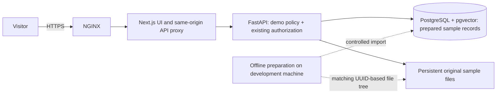

# Free public portfolio demo deployment plan

Hosting update: Oracle registration was unsuccessful. The proposed replacement
is [Vercel + Render + Supabase](render-free-demo.md). That review identifies the
remaining blockers and provides configuration drafts; no cloud resources have
been created. The Oracle discussion below is retained as the original plan.

Status: **analysis and proposed changes only; not ready to deploy unchanged.**
Implementation follow-up: the approved local demo implementation and tested
runbook are documented in [demo-local.md](demo-local.md). This document retains
the original planning decisions; it does not authorize cloud deployment.
Reviewed: 21 November 2026. No application code, live data, hosting resources, or
credentials were changed during this review. No OpenAI requests were made.

## 1. Recommendation

Run a **precomputed, read-only demonstration** on one Oracle Always Free Ampere
A1 VM, if capacity is available: NGINX HTTPS gateway, Next.js, FastAPI, and local
PostgreSQL/pgvector. Reuse the existing single-server deployment architecture.
Do not run the worker, OCR, embedding model, or any LLM provider publicly.

This is the simplest operational option because it avoids three hosting accounts,
cross-provider database connections, and Supabase inactivity pauses. All browser
requests use one origin; API and database containers remain private. Persistent
VM volumes contain the fictional database and original sample files.



**Zero ongoing API spend is achievable:** deploy without an API key, disable
generation, reject generation routes, and retain the private backend network.
**Free hosting and uptime cannot be guaranteed:** availability, reclamation,
quotas, provider policies, and abuse can interrupt the demo. Never upgrade to a
paid service to bypass a capacity problem under this budget.

A publicly trusted HTTPS hostname and certificate are launch prerequisites.
An existing domain can be used; purchasing one would break the strict $0 goal.
Otherwise select a free DNS/subdomain service after verifying its current terms
and certificate-renewal support. Do not substitute self-signed public TLS or
disable secure cookies. A working free hostname has not been provisioned or
validated in this review.

## 2. Repository findings

| Area | Existing implementation and consequence |
| --- | --- |
| Frontend | Next.js App Router, React, TypeScript, Tailwind; standalone Docker output. Protected pages call `requireUser()`. The UI is not a static export. |
| API communication | `frontend/src/lib/proxy.ts` forwards an allowlisted set of routes through `/api/backend/`, including cookies, Origin, CSRF, and response cookies. Browser requests can remain same-origin even with a separate API host. The proxy currently forwards write operations. |
| Backend | Modular FastAPI/SQLAlchemy/psycopg application with production configuration validation, request limits and sanitized errors/logs. No public read-only/demo policy exists. |
| Authentication | Argon2 password hashing, JWT access cookies, database-backed sessions, rotating refresh tokens and CSRF checks. Secure cookies use `__Host-`, HttpOnly, SameSite=Lax and path `/`. Ordinary Member membership still permits writes; it is not a demo permission. |
| Authorization | Organization membership checks, document authorization, source validation, and user-owned conversations. A demo must preserve these checks rather than bypass them. |
| Database | Seven migrations, ending at `0007_provider_requests`. Identity, documents/jobs/sections/chunks/revisions, vectors/conversations/messages, structured analysis/reviews, operations, and provider tracking already exist. First migration enables `vector`. |
| Embeddings | Lazy cached CPU Sentence Transformers encoder; default `all-MiniLM-L6-v2`, pinned revision, 384 dimensions. Query-time semantic search requires the encoder as well as stored vectors. Retrieval uses cosine distance with organization/profile/document filters; do not describe this as an existing HNSW index. |
| Processing | PostgreSQL-backed document/embedding and analysis jobs, leases, retries, stale-result checks, bounded extraction and OCR. The separate worker is unnecessary when no public operation can enqueue work. |
| OCR/dependencies | Backend image installs Tesseract and includes native Python packages and PyTorch. The lock pins `torch==2.15.0+cpu`; ARM installation of this exact lock/image has not been verified. Disabling features does not remove their image dependencies. |
| Storage | Local storage adapter uses organization/document UUID paths and an `original` file. Downloads remain API-authorized. PostgreSQL alone does not preserve downloadable originals. |
| Evidence | Stored conversation responses revalidate citations against live chunks/documents. Structured analyses depend on retained revisions and evidence. Preserve IDs, source text and file relationships during import. |
| Production | Separate Compose file, private data network, persistent database/documents/models volumes, one-shot migrations, runtime/migration secrets, resource limits and TLS gateway. The default file starts a worker and local database; a demo-specific Compose configuration is required. |
| Readiness | Production `/api/v1/health/ready` checks database, vector, migration head, and **writable** storage. It does not require a worker. A read-only storage deployment needs a demo-specific readability check. |

Inspected entry points include `backend/app/core/config.py`, `main.py`,
`api/dependencies.py`, API route modules, `services/auth.py`, `core/security.py`,
`documents/storage.py`, `documents/worker.py`, intelligence embedding/retrieval
modules, Alembic versions, Dockerfiles/lock files, frontend proxy/server guard,
`compose.production.yaml`, and the existing deployment/setup documentation.
Environment examples were reviewed; real `.env` values are not needed in this plan.

## 3. Hosting options and feasibility

### Oracle Always Free

Current official documentation gives **1,500 OCPU-hours and 9,000 GB-hours per
month**, equivalent to **2 OCPUs and 12 GB RAM for an Always Free tenancy**.
Do not use the older 4 OCPU/24 GB assumptions. Instances must be in the home
region; capacity can be unavailable. Idle instances may be reclaimed. Check the
actual console allowance and aggregate usage before provisioning.
[Oracle Always Free resources](https://docs.oracle.com/en-us/iaas/Content/FreeTier/freetier_topic-Always_Free_Resources.htm)

ARM is a reasonable target for the API and frontend, but the **complete pinned
image is not yet proven on ARM**. Build natively and verify all native wheels,
including PyTorch, PyMuPDF, psycopg, lxml and Argon2, plus image manifests for
PostgreSQL/pgvector and NGINX. Do not silently run x86 emulation or compile a
large ML stack on a tiny server. If the lock fails, prefer a small, tested demo
runtime dependency set that excludes unused processing/ML packages, after
checking imports. Keep the normal development/full-worker build intact.

Two OCPUs and 12 GB should be sufficient for this small, non-ML demo based on its
architecture, **not a measured capacity result**. Start one API process with
bounded concurrency, small database pools, log rotation and pagination; measure
memory/CPU before launch. The 1 GB AMD micro shape is not the recommended fallback
for the combined Next.js, Python and PostgreSQL stack.

### Vercel Hobby frontend

Suitable for a personal, non-commercial portfolio within Hobby terms and quotas.
The frontend needs server rendering and route handlers; use Vercel's Next.js
deployment rather than static export. Set project root to `frontend`, retain the
lockfile, and use the supported Node runtime. Verify the installed Next.js
version against Vercel's build/runtime before launch.
[Vercel Hobby terms and limits](https://vercel.com/docs/plans/hobby)

`BACKEND_URL` stays server-only and must point to a reachable, trusted HTTPS API
origin. Existing proxy/HttpOnly cookie handling is a useful fit; cookie Domain
must remain unset. Do not put the database URL, signing secret or provider key
in Vercel or `NEXT_PUBLIC_*` variables. Vercel serverless storage is not the
document store and its functions are not the existing long-running worker.

Functions have a 4.5 MB request-body limit and a response limit with a streaming
exception. Keep sample downloads comfortably below 1 MB and test the actual
proxy path; do not assume streaming bypasses every platform constraint. Disabled
uploads mean the normal application's 20 MiB upload capability is not offered
on this demo. Check current compute/transfer quotas before launch.
[Vercel function limits](https://vercel.com/docs/functions/limitations)

Vercel is feasible, but not needed for the recommended single-VM option.

### Supabase Free PostgreSQL

Supports pgvector. Current Free allocation includes a **500 MB database**,
shared CPU/500 MB RAM, **5 GB egress**, **5 GB cached egress**, and **1 GB file
storage**; free projects can pause after a week of low activity. These quotas
are separate, not one interchangeable allowance. A small curated dataset should
fit, but measure database size including indexes and retained histories.
[Supabase pricing](https://supabase.com/pricing),
[pausing policy](https://supabase.com/docs/guides/platform/free-project-pausing),
[pgvector support](https://supabase.com/docs/guides/database/extensions/pgvector)

Use Supabase as PostgreSQL only; retain DocuMind authentication and SQLAlchemy.
Do not introduce Supabase Auth or browser database access. Disable the Data API
for application schemas, or revoke all unintended `anon`/`authenticated` access
and verify schema exposure. Existing backend authorization is not Supabase RLS.
Never assume an application table is private merely because no client uses it.

The free direct connection uses IPv6; the shared **session** pooler provides
IPv4. Select the session pooler when IPv6 is unavailable. Verify psycopg startup
options, prepared statements, connection limits and SSL certificate validation;
do not default to transaction pooling without compatibility tests. Use separate
migration and runtime credentials with least privilege. Verify extension schema
and `search_path` against existing vector migrations on a disposable database.
[Supabase connection options](https://supabase.com/docs/guides/database/connecting-to-postgres)

For hundreds of 384-dimensional vectors, raw vector values occupy well under
1 MB; actual tables, text, indexes and histories add overhead. Target a measured
database under 100 MB for this demo rather than filling the allowance.

Do not use Supabase Storage initially: the application currently needs a local
storage adapter. Store the few originals on the Oracle persistent volume.

### Decision table

| Option | Assessment |
| --- | --- |
| Oracle: frontend + API + local database | **Recommended.** Closest to existing production topology; one host to maintain. Requires free capacity, ARM validation, HTTPS hostname and backups. |
| Vercel + Oracle API + Supabase | Feasible alternative. More accounts, external TLS/database networking, quota monitoring and pause recovery. No worker required. |
| Vercel + Oracle API + Oracle database | Useful middle option if Vercel hosting is preferred; database stays private on VM. Still needs publicly reachable HTTPS API. |
| Static screenshot/case-study showcase | Safest fallback if no free VM is available. No live backend workflows; clearly label it as a showcase, not an interactive application. |

Do not add another sleeping free Python service or a tunnel as an unverified
substitute. No configuration here guarantees uninterrupted free availability.

## 4. Required repository changes after approval

1. Add an explicit backend `DEMO_MODE` configuration, default **false**, with
   startup validation for a dedicated seeded organization and viewer identity.
   These are **proposed settings, not currently implemented variables**.
2. Add a centralized backend demo route/method allowlist that executes before
   upload parsing, expensive processing, queue insertion or business writes.
   Unrecognized routes fail closed. Maintain existing authentication and source
   authorization inside allowed routes. Test direct API calls as well as proxy calls.
3. Add a narrow demo-entry endpoint and UI button, reusing existing session,
   refresh-cookie and CSRF machinery. No published password or frontend admin
   credential. Each visitor gets an independent session for a dedicated demo
   Member identity, restricted to the demo organization. Shared conversations
   are deliberately seeded for that identity and read-only.
4. Limit demo-entry/refresh frequency and session count; bound session lifetime
   and prune expired session/token rows during bounded maintenance/entry cleanup.
   No per-visitor user creation. Logout revokes only the caller's session.
5. Add frontend demo capabilities/banner, contextual disabled-action explanations
   and historical-answer navigation. Preserve all normal app controls when demo
   mode is off. Separate historical response provenance from current disabled
   generation status; never relabel a saved mock answer as GPT.
6. Add repeatable offline seed/export/import tooling, fixtures and manifest with
   document checksums, source IDs, analysis IDs, snapshot date and provenance.
   Existing portfolio capture tooling is useful input but destroys its temporary
   database; it is **not** a production seed/import command.
7. Add a separate demo Compose configuration and deployment examples. Do not
   merge development Compose into production or modify local `.env` behavior.
   No worker/model-preparation service or OpenAI egress overlay in the demo.
8. Mount original documents read-only and adapt production readiness **only in
   demo mode** to require readable, matching files instead of writable storage.
   Add demo startup checks for provider disabled and valid dataset identity.
9. Add a least-privilege demo runtime database role: SELECT on required business
   tables; necessary DML only on auth session/refresh-token tables. Migration and
   seed roles remain separate and are not mounted in the running API. No public
   request uses an owner credential.

No new workflow engine, worker queue, paid integration or business-schema
redesign is needed. Configuration plus existing models should suffice; confirm
whether any migration is actually needed during implementation.

### Backend permission matrix

| Public demo operation | Policy |
| --- | --- |
| Dashboard, document lists/details/content | Allow reads within the seeded organization. |
| Original sample downloads and source passages | Allow authenticated, authorized reads of seeded files only. |
| Saved conversations/messages/citations | Allow reads of the dedicated viewer's seeded history; retain ownership/source checks. |
| Existing extraction/comparison/risk/obligation results, reviews and activity | Allow authorized reads, including preserved reviewer history. |
| CSV/JSON exports | Allow only existing authorized, bounded read exports; retain safe CSV formatting. |
| Demo entry, CSRF, session refresh/logout | Narrow exceptions for session operations; CSRF/Origin checks remain enabled. |
| Registration, password login, new organizations/membership changes | Deny in public demo; no production account administration exposed. |
| Upload, retry, indexing, reprocessing, deletion | Deny before storage or enqueueing. |
| New conversations/messages, semantic search, analysis/comparison runs | Deny. Search is POST and requires a local encoder even though logically a read. Library text filters can remain. |
| Templates, review decisions, corrections, assignments, obligation changes | Deny. Show existing states/history without saving changes. |
| Admin diagnostics and unknown/new endpoints | Deny by default. Retain basic health/readiness with sanitized output. |

Do not equate GET with safe automatically: audit every allowed read for side
effects. HEAD/OPTIONS must not bypass policy. UI disabling and CORS are not
authorization. Session identities and organization IDs are resolved server-side;
client-supplied IDs must not expand scope. Membership enforcement remains in place.

## 5. Sample data and provenance

Prepare in a **new isolated database and file directory**, never by exporting the
personal development database wholesale. Use approximately 6–10 short fictional
PDF/DOCX/TXT agreements, policies and project documents. Include two revisions
for comparison, sensible deterministic extraction/risk findings, obligations,
completed reviews and assignments, and a few saved cited conversations.

Run extraction/OCR, embedding indexing and deterministic analysis locally before
publication. Stop the worker after all jobs finish and validate no pending,
running or retryable work remains. Keep completed job metadata when useful.
Preserve source revisions, sections, chunks and profile identifiers. Precomputed
vectors may remain stored without loading the encoder publicly.

Saved mock answers must say **development mock / extractive preview**, and the
public UI must say generation is disabled. The current production validator
rejects `LLM_PROVIDER=mock`; keep `LLM_PROVIDER=disabled` and display the stored
message's own provenance. No need to weaken that validator.

The repository contains a developer-supplied record of a successful real paid
OpenAI test, but its verification note explicitly says no raw provider log or
authentic live-request screenshot was located. Do not manufacture a GPT database
response or cost ledger from that note. Import an already-existing genuine result
only after sanitizing and verifying its actual stored response, usage and matching
source evidence. If unavailable, show labeled mock history and link to the
documented local test separately. Make no new paid calls to seed the demo.

Use fictional people and `example.com` addresses. Remove authentication sessions,
refresh tokens and real credentials from any preparation export; create fresh
deployment secrets. Seed a dedicated viewer and fictional historical reviewers.
Show a dataset snapshot date so overdue deadlines and historical processing
activity are not mistaken for current customer activity. Preserve existing
portfolio counting semantics rather than inventing metrics.

## 6. Environment, secrets and networking

Existing backend settings for the deployed demo:

```dotenv
ENVIRONMENT=production
COOKIE_SECURE=true
LLM_PROVIDER=disabled
LLM_REAL_REQUESTS_ENABLED=false
EMBEDDINGS_ENABLED=false
OCR_ENABLED=false
```

Also require an independently generated `AUTH_SECRET` via mounted secret file,
the dedicated runtime `DATABASE_URL`, explicit `ALLOWED_HOSTS`, the exact HTTPS
frontend `CORS_ORIGINS`, and the seeded `STORAGE_PATH`. Do not copy real local
`.env` files. Leave `LLM_API_KEY` and `LLM_API_KEY_FILE` entirely absent; do not
rely on zero cost estimates or daily budgets to stop charges. They are not a
substitute for disabling the provider.

For the recommended topology, keep server-only frontend `BACKEND_URL=http://api:8000`.
Expose only HTTPS/HTTP gateway ports; restrict SSH to operator access. No public
PostgreSQL, API or worker ports. Keep API on the existing internal data network;
omit the OpenAI overlay. Document volume is read-only in the API container.

For the split option, use `BACKEND_URL=https://<api-hostname>` on Vercel, exact
`https://<project>.vercel.app` as the allowed frontend origin, and trusted backend
hostnames. DNS names are placeholders, not configured resources. The Oracle
gateway needs an API-only upstream configuration; the existing NGINX template
routes to Next.js, so it cannot be used unchanged for an API-only deployment.
Keep backend policy effective for direct requests to that public API. A Supabase
connection needs narrowly scoped outbound database access from the API network;
the current internal network cannot reach Supabase unchanged. This does **not**
justify adding OpenAI egress or publishing database ports.

Do not set cookie Domain, use wildcard credentialed CORS, disable CSRF, or weaken
HTTPS requirements to solve deployment issues. Keep auth/data responses uncached.
Do not attach production secrets/database to Vercel preview deployments; use a
separate test environment or disable previews until configured safely.

## 7. Deployment sequence after implementation approval

These steps are a runbook for future implementation. Demo files, seed commands
and demo-entry endpoints do not exist yet; do not deploy the current writable
application by following only the existing production startup command.

### A. Local preparation on Windows

1. Implement and review the changes in section 4 with `DEMO_MODE=false` as default.
2. Create a disposable database/storage root. Generate the fixture dataset with
   local OCR/embeddings/deterministic engines and labeled mock history as needed.
3. Verify citations, downloads, comparisons, review history and all read-only
   controls. Produce a sanitized database export and matching file archive with
   checksums. Exclude these operational dumps/secrets from Git.
4. Run the existing regressions plus new demo-specific tests. Existing commands:

```powershell
# Repository root; existing development environment already installed
.\backend\.venv\Scripts\python.exe -m pytest backend/tests
Push-Location frontend
npm ci
npm test
npm run lint
npm run typecheck
npm run build
Pop-Location
```

5. Rehearse the separate demo Compose deployment locally with isolated volumes
   and trusted test TLS; verify normal local development remains unchanged.
6. Build/test the actual Linux ARM64 images before declaring Oracle compatible.
   Do not infer successful ARM support from passing Windows tests. Record image
   tags, lock versions and database migration head in the release manifest.

### B. Provision only after explicit deployment approval

1. Check Oracle home-region free capacity and console pricing. Select only the
   Always Free-eligible A1 allocation within the **current aggregate** limit.
   Refuse a paid shape, paid account upgrade, extra disk or trial-only allocation.
2. Record boot/block-volume allowances and all network/egress quotas in the
   deployment notes. Do not assume every console default is free. No managed
   load balancer or paid DNS is required. If no free capacity exists, stop.
3. Install the supported Linux/Docker/Compose versions; apply OS updates and
   secure operator SSH. Configure cloud and host firewalls for 80/443 and restricted
   SSH only. Obtain the verified free/existing hostname and renewable TLS.
4. Transfer the approved application revision and sanitized fixture artifacts.
   Never transfer the local `.env`, existing production secrets or real documents.
5. Generate server-specific secrets, configure exact origins/hosts and demo IDs,
   and verify no API key/OpenAI overlay/worker is present.
6. Start only the private database. Apply existing Alembic migrations once with
   the migrator, verify `current` equals `heads`, and run `alembic check` on the
   prepared schema. Import fixture data/files through offline tooling; do not
   restore privileged role ownership or local session tokens.
7. Create/restrict the runtime role, verify business-table writes fail, and start
   API, frontend and gateway only. Confirm readiness checks the demo file mount
   appropriately. Never use `up -d` on the current full production Compose file
   expecting the worker to be omitted automatically.
8. Test every denial directly against the API as well as through the browser.
   Publish the link only after the launch gate in section 8 passes.

Exact demo Compose and seed/import commands should be supplied with their tested
implementation, rather than inventing commands for files not yet created.

### C. If choosing Vercel + Oracle + Supabase instead

1. Complete the same demo implementation, offline fixtures and ARM verification.
2. Create a Supabase **Free** project; record its inactivity behavior. Configure
   vector, schema exposure, TLS, restricted roles and session-pooler/IPv6 connection.
   Test all migrations and schema checks in this empty project before import.
3. Deploy the Oracle API-only HTTPS gateway/container and read-only original
   file volume. Remove the local database service and its dependencies from this
   separate topology; configure required outbound database connectivity.
4. Import sanitized sample records and matching files; measure database/egress
   usage. Do not add Supabase Storage or Auth to replace existing components.
5. Import the personal GitHub repository into a Vercel **Hobby** project with
   root `frontend`. Set server-only `BACKEND_URL`, standard Next.js build settings,
   and the supported Node runtime. No database/provider credentials are needed
   by Vercel. Confirm the project is eligible under current personal-use terms.
6. Set the exact stable Vercel production origin on the API; redeploy/restart
   configuration as needed. Verify refresh rotation, cookies, CSRF and proxy
   behavior end to end. Do not allow arbitrary preview origins.
7. Re-run the launch gate, including sample downloads through Vercel. Document
   manual Supabase resume and VM recovery steps beside the portfolio link.

## 8. Verification and launch gate

Required tests before publishing:

- All existing backend/frontend tests, lint, TypeScript and production builds.
- Seven migrations upgrade an empty PostgreSQL database; schema/head checks pass.
  For Supabase, repeat on its actual supported PostgreSQL/vector configuration.
- Anonymous users can enter the demo through the explicit flow, receive secure
  HttpOnly cookies, refresh and log out without shared-session revocation.
- Demo identity is a Member of exactly the intended organization. Other user,
  organization, conversation and source IDs return denial/404; no session value
  or arbitrary ID can elevate scope.
- Exercise all existing write routes with valid CSRF and valid cookies: each is
  denied except the explicit auth-session exceptions. Also test missing CSRF,
  HEAD/OPTIONS, direct API calls, and newly added/unknown routes.
- Patch encoder/provider/queue/storage-write entry points to fail if invoked;
  public browsing must never reach them. Confirm no OpenAI DNS/network request,
  provider ledger insertion, queued job or business-row change occurs.
- Test database role privileges independently. Confirm originals are immutable,
  readable and downloadable only through authorized API routes.
- Stored citations open exact source passages; stale/deleted source behavior
  remains correct. Risk/obligation candidates, deterministic findings and mock
  histories retain accurate labels. GPT provenance is shown only where genuine.
- Check exports, dashboard totals, filters, comparison revisions and review history
  against the seed manifest. Test mobile/desktop, light/dark, empty/error states.
- Verify TLS renewal, headers, exact CORS, no-store responses, logs without tokens
  or document text, bounded pools/concurrency, and normal local development mode.
- Test an isolated restore, API restart and database unavailability. Record actual
  memory/CPU/disk usage; no performance or uptime claim is established by this plan.

This review did not run application tests, ARM builds, cloud migrations or live
deployment checks: only a documentation file was added. Those are approval-stage
implementation checks, not results already obtained.

## 9. Backups, limitations and cost controls

Keep an offline sanitized dataset bundle and release manifest on the development
machine. Back up PostgreSQL and the matching original-file tree together after
each controlled dataset update. A database-only backup is insufficient for
downloads; an image backup alone is not a database restore test. Reuse the
existing deployment backup/restore procedures where compatible, adapted to the
separate demo topology, with backups downloaded off the VM. Never reset the
personal development database or restore a demo over it. Protect auth/session
rows in operational backups; do not commit backup archives.

| Risk/limitation | Control |
| --- | --- |
| OpenAI costs | No key mounted, provider disabled, real requests false, backend routes denied, no OpenAI network overlay. |
| Oracle paid resources | Remain on Free; inspect every resource and aggregate quota. No PAYG upgrade, paid shape, trial-dependent deployment or automatic scale-up. |
| VM capacity/reclamation | Accept interruption; retain offline fixtures and tested restore. Do not generate fake load to evade idle policy. |
| Vercel quotas/terms | Hobby personal portfolio only; no paid add-ons or automatic plan upgrades. Accept service limits rather than buying capacity. |
| Supabase limits/pause | Free project only, small measured dataset, bounded connections, manual resume if paused. No paid IPv4 add-on; session pooler when appropriate. |
| DNS/TLS | Use verified free/existing hostname and free certificate issuance/renewal. A newly purchased domain is an extra cost. |
| Public traffic/abuse | Bounded reads, gateway limits, small files, pagination, session caps/cleanup and rotated logs. Monitor disk/transfer; disable the demo if needed. |
| Free-tier changes | Recheck provider console/terms before provisioning and periodically afterward. Alerts help observation; they are not a hard spending cap. |
| Reduced functionality | No live upload, semantic queries, new chat answers, analyses or saved edits. Explain the read-only snapshot clearly and link to the full local setup. |
| Storage durability | Persistent volumes plus off-host backup; do not assume a free VM or managed free database provides guaranteed recovery. |

A $0 live demo is a **best-effort portfolio service**, not a production SLA.
If free capacity, a suitable free HTTPS hostname, or ARM build compatibility
cannot be secured, publish the existing case study/screenshots with a clear
interactive-demo-unavailable notice rather than creating billable resources.

## 10. Scope to approve next

Implement backend-enforced read-only mode, bounded demo sessions, prepared
fictional fixtures, frontend capability states, and an isolated demo deployment
configuration. First verify locally and on ARM; then separately approve any
resource creation/deployment. Keep the normal application and Windows workflow
unchanged. No application changes or cloud deployment are authorized by this
planning document itself.
