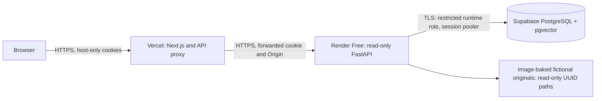

# Vercel + Render + Supabase: free demo deployment review

**Status: original feasibility review, followed by an approved local implementation.**
See [the prepared deployment runbook](render-deployment.md) for current controls,
packaged fixtures, tested commands and the remaining live approval gates. The
blockers below document the original review; they are not instructions to bypass
the implemented safeguards. No service was created or deployed.

This replaces Oracle as the proposed public hosting target. The already verified
[local Docker demo](demo-local.md) remains intact.

## Recommendation and measured feasibility

Use Vercel Hobby for the existing Next.js frontend/proxy, one Render Free Docker
web service for FastAPI, and one dedicated Supabase Free PostgreSQL project.
Keep original fictional files **inside the backend image**; keep database rows
and auth sessions in Supabase. No Render database, disk, worker, cron, model
download, OCR process or paid AI integration is required.

Read-only measurements from the existing local demo:

| Measurement | Observed |
| --- | --- |
| Running API container memory | Approximately 95.5 MiB idle, from Docker stats |
| Original sample files | Six files, 39,360 bytes total |
| Local demo database | 9,459,379 bytes, about 9 MiB |

These are not Render benchmarks, peak RSS measurements or a Supabase project-size
prediction. Supabase adds managed schemas/services; free-tier performance and
availability remain unverified. A small, single-process, non-ML API is plausible
within 512 MB, but deployment must wait for capped-memory/concurrency tests.

## Blockers and decisions before application implementation

### 1. Supabase database identity

The current demo validator and seed require `documind_demo*`; the grants CLI
requires exactly `documind_demo`. Supabase's standard connection targets
`postgres`. Changing only the connection string will fail safely at startup.

Two choices exist:

- **Standard managed path:** a new, dedicated Supabase project using its `postgres`
  database. Before implementation, approve replacing the database-name-only check
  **for this explicit target** with a pinned project reference/connection identity,
  restricted runtime role, and the existing organization/viewer/fictional-source
  checks. Do not simply allow arbitrary databases named `postgres` or disable
  `DEMO_MODE` to start the service. A controlled fixture importer and privilege
  setup must follow the same target checks. This is the recommended predictable
  provider connection path, but needs a reviewed security-guard change.
- **Preserve the current database-name guard:** use a manually created database
  named `documind_demo` in a dedicated Supabase project. Supabase documents such
  databases, with no Dashboard/Data API/Auth/Storage integration. Confirm the
  chosen session pooler, custom role, extensions, backup path and permissions
  actually support this database before selecting it. This could avoid the
  guard change, but no Supabase project was created to verify it. Do not assume
  replacing `/postgres` with `/documind_demo` in a URL is sufficient.

[Supabase custom database caveats](https://supabase.com/kb/troubleshooting/manually-created-databases-are-not-visible-in-the-supabase-dashboard-4415aa)

### 2. Dataset packaging and import

The local demo stores original files on a Docker volume. Render Free does not
provide that volume. A controlled export of the **fictional demo only** must
produce matching immutable originals, a checksum/version manifest, and sanitized
records for the selected target. Do not export the development database. Do not
include session tokens, password credentials, provider keys or private documents.
Create fresh inaccessible viewer/reviewer passwords during import, preserving
their IDs and review history. Keep existing source/chunk/revision IDs unchanged.

No export/import tool was written here because its allowed database-target
validation depends on the decision above. The image template intentionally fails
to build without the prepared fixture directory. It is not deployable today.

### 3. Cold starts versus current timeouts

Render sleeps idle services and may take about a minute to wake. Current frontend
limits are 10 seconds for the server auth guard, 15 seconds for the general proxy
and API client; intelligence requests have a longer proxy timeout, but the client
can still stop earlier. Raising just one timeout is insufficient.

Implement a demo-only bounded wake/status flow before visitor entry and useful
retry messaging for returning visitors. Individual proxy calls should remain
short; allow the browser to wait/retry explicitly, without holding one long
Vercel invocation or retrying mutations blindly. Do not weaken authentication,
refresh-token replay detection or CSRF to accommodate sleeping services.

### 4. The current NGINX rate limits disappear

Render and Vercel replace the local gateway. Backend business-write restrictions
remain valid, including direct requests to the public Render URL; CORS is not
authorization. However, the NGINX demo-entry/request throttles will not transfer.
Before launch add a small bounded backend demo-entry limit (in addition to the
existing global session cap/refresh bounds) and verify its behavior through
Vercel. Do not trust arbitrary forwarded client-IP headers. A simple global
entry limiter is an initial option; it must be labeled global rather than
incorrectly claiming per-visitor isolation. No Redis or extra service is needed.

These are the changes to approve before treating the drafts as a runnable
deployment. Application guards have been left untouched.

## Render memory and dependencies

Render Free currently provides **0.1 CPU / 512 MB RAM**.
[Render compute plans](https://render.com/docs/compute-plans)

The full backend lock includes PyTorch, Sentence Transformers, Transformers,
NumPy/SciPy and extraction dependencies. Disabled features are mostly lazy-loaded,
which explains the modest observed idle memory. Installed image size is not the
same as runtime RSS. Do not claim the full image necessarily exceeds 512 MB.

Start with one Uvicorn worker and concurrency 8. Preserve Argon2 parameters; its
startup dummy hash has a memory/CPU cost and must be included in peak testing.
Do not start Gunicorn worker pools or the document worker. Keep a small database
connection pool: target two pooled connections with at most one overflow for
the public demo, with existing normal-development defaults unchanged. The current
SQLAlchemy defaults are larger; this requires a scoped configuration change.

The Docker draft reuses the **unchanged full requirements lock** and excludes
OS Tesseract. It does not download a model or start extraction. This avoids an
unreviewed dependency fork, but builds remain large/slow. If build quotas make
this impractical, later approve a dedicated runtime-only lock derived from the
existing exact pins and validate the complete API import graph. Do not silently
drop `pgvector` or assume it can operate without its own dependencies. No slim
lock, upgraded version or ARM workaround was introduced in this review.

Future local gate: build the prepared image and exercise startup, entry, saved
answers, evidence and exports under `--memory=512m` and constrained CPU. Record
peak and steady memory, response times and OOM events. The existing idle reading
alone does not satisfy that gate.

## Sample files without paid storage

The simplest choice is **image-baked files**, not Supabase Storage or runtime
uploads. Copy the six approved originals and manifest into `/data/documents`,
preserving `<organization UUID>/<document UUID>/original`. Root-own the files,
remove write permissions and run FastAPI as the existing non-root user. Continue
serving downloads only through authorized endpoints; do not add public static
URLs or expose this directory through Vercel.

An image rebuild restores these packaged bytes on every restart; filesystem
ephemerality affects runtime changes, not committed image layers. Database
checksums must match the chosen image manifest. Import records before startup
so existing dataset validation passes. Dataset updates are coordinated database
and image releases; never regenerate different UUIDs independently during build
or service startup. Do not store mutable sessions or the database in the image.

No persistent disk, bucket, external fetch on wake or storage API key is needed.
Supabase Storage is a possible later adapter, but adds permissions, network calls
and code without helping this approximately 39 KB fixed dataset.

## Supabase connections, migration and isolation

Use the **shared session pooler on port 5432** for an IPv4-compatible connection.
Transaction mode on 6543 is unsuitable for assuming existing session behavior:
Alembic currently takes a session-level advisory lock. Do not run those migrations
through transaction pooling. Keep the driver `postgresql+psycopg` and existing
SQLAlchemy models; do not add Supabase Auth or a browser database client.
[Supabase connection guidance](https://supabase.com/docs/guides/database/connecting-to-postgres)

Validate the actual pooler with the exact custom runtime/migration usernames,
password encoding, TLS and `connect_args.options`. Existing engine construction
sends `statement_timeout` and `lock_timeout` as startup options; acceptance has
not been tested against a live Supavisor endpoint. If rejected, use a reviewed
session-initialization alternative, retaining limits rather than deleting them.
Do not silently switch pooler mode or use an owner credential to fix login.

Require TLS with hostname/certificate verification. Obtain the appropriate
trusted CA using Supabase's connection guidance and supply it to libpq, for
example via `sslrootcert`/`SSLROOTCERT`; do not assume downloading a certificate
configures psycopg automatically. On Render a required non-secret CA can be baked
into the image or mounted as a secret file. Verify the selected pooler's CA;
never disable verification to make a connection work.

Apply the seven existing migrations from the operator's machine, with a separate
migration credential. Render Free has no pre-deploy job/operator shell; the
Blueprint deliberately declares neither. Do not migrate or reseed on every
application startup, or give the Render runtime an admin URL. Verify vector is
installed in the selected database and visible through the expected search path;
test `alembic current`, `heads` and `check` on that target.
[Render Blueprint pre-deploy restrictions](https://render.com/docs/blueprint-spec#predeploycommand)

The local `deploy/demo/init-db.sql` uses privileged filesystem secret reads and
local role/schema bootstrap assumptions. It is **not** a Supabase bootstrap
script. The current grants CLI also targets a locally named role/database. A
provider-compatible reviewed role/privilege setup is required before launch.

Use a dedicated demo project, not an existing personal/product database. On the
standard `postgres` path disable Data API exposure for application schemas (or
explicitly deny all unintended `anon`/`authenticated` privileges). The API runtime
gets SELECT on application business tables and only necessary DML on session/
refresh-token tables. Do not grant blanket privileges on Supabase-managed schemas
or alter their ownership. Existing application authorization is not Supabase RLS.

## Authentication and platform configuration

The browser stays on `https://<project>.vercel.app`. Both page guards and
`/api/backend/...` call Render server-side using `BACKEND_URL`. Keep the current
cookie forwarding and multiple `Set-Cookie` handling. Cookies remain HttpOnly,
Secure, SameSite=Lax, host-only, path `/`, with `__Host-` names. Do not set a shared
Domain or switch to localStorage tokens. They belong to the Vercel browser origin,
not the backend hostname.

Keep the exact Vercel production origin in backend `CORS_ORIGINS`; the proxy
already forwards Origin and CSRF. The server guard's GET does not require an
Origin header. Use an explicit Render hostname plus localhost health-check hosts
in `ALLOWED_HOSTS`. No wildcard origins/hosts or disabled CSRF. Render and Vercel
provide public HTTPS hostnames, so a purchased domain is unnecessary.

On Vercel choose Root Directory `frontend`, supported Node runtime, standard
Next.js build, and `DEMO_MODE=true` at **both build and runtime**. Static login
pages consume the build flag. Configure only server-side `BACKEND_URL` and the
non-secret demo appearance flag. No provider key, database URL, signing key,
Supabase service key or `NEXT_PUBLIC_*` token belongs there. Do not attach real
demo credentials to arbitrary preview deployments.

The Vercel JSON draft carries over the existing gateway's practical response
headers without adding a script policy that would break Next.js. Keep the
existing no-store auth/data behavior. Verify Vercel routing/cookies/security
headers on actual deployment; standalone Docker output is not itself a blocker
to a standard Next.js Vercel build.

Render receives the restricted runtime `DATABASE_URL`, a newly generated signing
secret, demo IDs, exact origins/hosts and `STORAGE_PATH=/data/documents`.
Enforce `DEMO_MODE=true`, production secure cookies, `LLM_PROVIDER=disabled`,
`LLM_REAL_REQUESTS_ENABLED=false`, `OCR_ENABLED=false`, `EMBEDDINGS_ENABLED=false`.
Leave all API-key variables and files absent. Provider/worker refusal and the
read-only route policy remain essential because Render has outbound connectivity;
unlike the local Compose API, it is not on a Docker-internal network.

## Free-tier limits and cost prevention

- Render: sleeps after 15 idle minutes; wake can take about a minute. Files written
  at runtime are lost, there is no free persistent disk, and 750 instance-hours
  are shared per workspace/month. Bandwidth/build quotas can bill supplementary
  usage when a payment method is attached; without one, bandwidth exhaustion
  suspends services. Build spend limits and actual dashboard allowances must be
  checked. High service-initiated traffic may also cause suspension. No uptime
  guarantee, fake keepalive traffic or second service is proposed.
  [Render Free limitations](https://render.com/docs/free)
- Supabase: Free includes a 500 MB database, 5 GB egress and 1 GB object storage;
  low-activity projects can pause after a week. No Storage allocation is needed
  here. Pause/resume and off-platform backups are operator responsibilities.
  Do not buy an IPv4 add-on, upgrade the project, or share the demo's connection
  budget with another application.
  [Supabase pricing](https://supabase.com/pricing),
  [inactivity policy](https://supabase.com/docs/guides/platform/free-project-pausing)
- Vercel: Hobby is for personal/non-commercial use. This portfolio fits that
  purpose while it remains a personal demonstration, not a customer service.
  Monitor function/transfer quotas; do not upgrade or enable paid marketplace
  add-ons. The small originals avoid large proxy payloads.
  [Vercel Hobby](https://vercel.com/docs/plans/hobby),
  [function payload limits](https://vercel.com/docs/functions/limitations)
- OpenAI: no key, provider disabled, generation routes denied, no worker. No real
  API request is needed for deployment or verification. Stored mock history must
  remain labeled mock; no synthetic GPT usage rows may be introduced.

The strict $0 policy means accept suspension/unavailability rather than paid
overage. If registration requires a paid plan or the account's payment/overage
controls cannot enforce the intended policy, stop. Do not treat budget alerts
as a guaranteed hard spending cap. Free-tier availability and terms can change.

## Prepared configuration files

- `deploy/render/render.yaml.example`: one explicitly Free Docker web service,
  manual deploys, sanitized health checks and runtime variables; no paid services.
- `backend/Dockerfile.render-demo.example`: draft non-root, single-worker image,
  fixed sample file packaging and unchanged dependency pins. Deliberately not
  buildable until the approved fictional assets are prepared.
- `deploy/render/vercel.json.example`: Next.js build/settings and security headers;
  after approval place it at `frontend/vercel.json` for the frontend project root.
- `deploy/render/frontend.env.example`: the only two frontend deployment settings.

The examples do not create resources or deploy automatically. The Render
Dockerfile/context paths are repo-relative; use the specified `backend` context
so its existing `.dockerignore` excludes local `.env`, model cache and documents.
Do not copy the entire repository into an image or export secrets into a build
argument. Filesystem secrets supplied by the operator must remain outside Git.

## Approved-next-step checklist, not deployment commands

1. Choose the database identity path and approve any required guard/import changes.
2. Add controlled fixture export/import, backend entry limits, demo-only connection
   limits and cold-start UX. Keep full local behavior and all pins unchanged.
3. Prepare immutable fictional assets and matching records; no real database dump.
4. Test the candidate image locally at 512 MB, direct/proxy write denials, cookie
   refresh/logout, restarts and exact source checksums. Re-run relevant regressions.
5. Only after separate resource-creation approval: create a dedicated Free Supabase
   project, confirm selected pooler/TLS/custom role/database support, apply migrations
   and import fixtures from the operator machine; retain offline backups.
6. Review/copy the configuration drafts, then separately approve creating Render
   Free and Vercel Hobby services. No owner database credentials on Render.
7. Verify actual cold/warm access, pause recovery, anonymous denial, source clicks,
   exports, runtime privileges, memory peaks and absence of provider calls.
8. Publish only after those checks pass. Keep the local case study as fallback
   during service sleep, pausing, quota exhaustion or provider outages.

No cloud compatibility tests were performed in this review because no hosting
resources were created. Draft JSON/YAML can be syntax-checked locally, but that
is not a platform validation, image build, memory benchmark or successful deploy.
